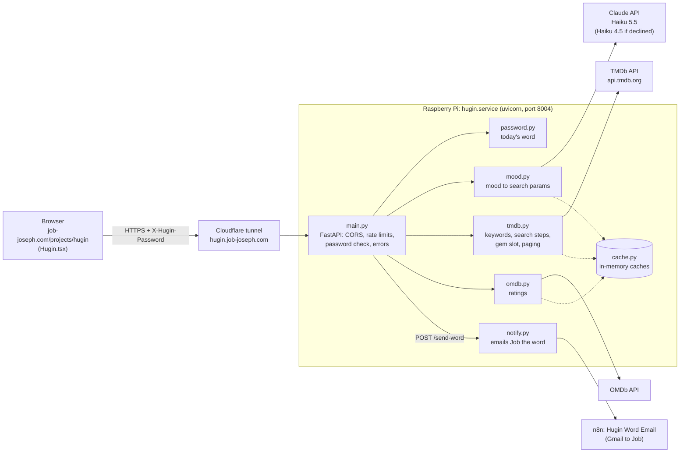

# Hugin — Product Spec

## Problem statement

Choosing what to watch is harder than it should be. Streaming platforms offer thousands of options but no way to say "I'm in a weird mood, something dark but funny, nothing too long." Genre filters are too coarse. Algorithms optimize for engagement, not for what you actually feel like watching right now. And when you're watching with other people, there's no tool that resolves multiple preferences into a shared pick.

Hugin solves this by turning a free-text mood description into a curated shortlist of movies, using Claude to interpret nuance and TMDb/OMDb for the actual data.

## Pain points solved

1. **Decision fatigue** — too many options, no clear starting point. Hugin returns exactly 5 picks (solo) or 3 picks (group), not a scrollable grid.
2. **Recommendations ignore mood** — genre dropdowns can't capture "something cozy but not boring" or "I want to feel unsettled." Free text can.
3. **No group watch solution** — no existing tool takes 3 people's moods and finds the intersection. Hugin's group mode does exactly this.
4. **Hidden gems stay hidden** — algorithms push popular content. Every solo search ends with a hidden gem (300–3,000 votes, rated 7.5+, out for at least a year), and asking for "hidden gems" makes every pick one.

## How it fits together



What happens on a solo request (`POST /recommend`):

1. **Gate** — `main.py` checks the rate limit and the `X-Hugin-Password` header against today's word (`password.py`). A wrong word stops here with a 401; Claude is never called.
2. **Interpret** — `mood.py` asks Claude to turn the mood into search parameters: genres, keywords, a rating floor, sort order and whether the user wants hidden gems. The reply is validated, and the same mood reuses its interpretation for an hour.
3. **Search** — `tmdb.py` matches the keywords to TMDb tags, then walks the search steps (most specific first) to pick 4 films, and runs the gem search for the 5th.
4. **Enrich** — TMDb details (runtime, genres, IMDb id) are fetched one after another, then OMDb ratings in parallel. Both are cached, and a failed lookup only loses that film's extras.
5. **Respond** — the 5 films (each with `is_gem`) and the parameters Claude chose (`params_used`).

Group requests (`POST /recommend-group`) follow the same path with one Claude call for all the moods, and return 3 films with no gem slot. Everything is in-memory: no database, nothing stored about users.

## Architecture decisions

### Why FastAPI

Job already built the Word Translator project with FastAPI. Same pattern, same deployment target (Render at the time; Hugin now runs on the Pi behind a Cloudflare tunnel), minimal learning curve. FastAPI's native async support matters because every request fans out to Claude + TMDb + OMDb.

### Why no database

There's nothing to persist. No user accounts, no watch history, no saved preferences. The password rotates deterministically from a seed. Adding a database would be pure overhead for this use case.

### Why TMDb + OMDb

TMDb has the best Discover API — it supports filtering by genre, vote average, vote count, and keyword in a single call. But TMDb doesn't expose Rotten Tomatoes scores. OMDb does, via the shared imdb_id. The two APIs complement each other: TMDb for discovery, OMDb for the ratings people actually care about.

### Why Claude as the interpreter

The core insight: mood-to-query translation is a natural language understanding problem. "Something funny but not dumb" needs to become `{genres: [35], vote_floor: 7.0, sort_by: "vote_average.desc"}`. Rule-based keyword matching would be brittle. Claude handles nuance, slang, and multi-mood group intersections natively.

### Why n8n sends the daily-word email

Job's n8n already has a Gmail login and a webhook-to-email workflow (Sentinel's alerts), so the raven reuses that pattern instead of putting SMTP credentials in Hugin. Hugin only needs one secret URL, and the recipient lives in n8n, outside anything the browser can reach.

## Password mechanic

Hugin is gated by a daily password that rotates at UTC midnight:

1. `SHA-256(HUGIN_SEED + "2026-04-25")` produces a hash
2. First 4 bytes of the hash are converted to an integer
3. `integer % 29` indexes into WORD_LIST (29 words: ember, dusk, reel, etc.)
4. The resulting word is today's password

The seed is a long random value that exists only in `.env` on the Pi.

The backend checks the password: `POST /verify-password` for the gate, and an `X-Hugin-Password` header on every recommendation call (enforced in production via `HUGIN_REQUIRE_PASSWORD=1`). Yesterday's word is accepted for the first hour after UTC midnight; case and spaces are ignored. Wrong guesses are rate limited and never reach Claude.

Job can get the word without a terminal: tapping the raven on the page 3 times emails it to him (see [POST /send-word](#post-send-word)).

The old `GET /password-hash` endpoint was removed: its prefix gave the word away (its first 8 hex characters are the bytes that pick it), and the frontend never used it. The page no longer knows the seed: until November 2026 it derived the word in the browser from a seed hardcoded in Hugin.tsx, so the seed was rotated when the server-side check went live.

## Mood-to-params logic (mood.py)

Claude (Haiku 5.5 at low effort; a declined request is retried once on Haiku 4.5) receives a system prompt defining it as Hugin, a movie mood interpreter. Given a mood string, it returns a JSON object. Structured outputs (`output_config.format` with a JSON schema) constrain the reply to this shape:

| Field | Type | Description |
|-------|------|-------------|
| genres | int[] | TMDb genre IDs (e.g. 35 for Comedy) |
| keywords | string[] | TMDb keyword strings, 2-4 words each (matched to real TMDb tags; unmatched ones are dropped) |
| vote_floor | float | Minimum vote average, range 5.5-8.0 |
| gem_mode | boolean | True ONLY for explicit hidden/obscure/underrated requests — not mood words like "dark" or "tense" |
| sort_by | string | "vote_average.desc" or "popularity.desc" |

The reply is model output shaped by user text, so it is never trusted. `_parse_response()` and `_clean_params()`:
- Strip markdown code fences or a sentence around the JSON (safety net — structured outputs should prevent both)
- Map genre name strings to TMDb IDs and drop anything not in the 18 known genre IDs
- Clamp vote_floor to 5.5–8.0 (non-numbers fall back to 6.5)
- Fall back to "vote_average.desc" for any other sort_by (after appending a missing ".desc")
- Treat gem_mode as true only for the boolean `true` (the string "false" is not true)
- Drop any keys outside the five above, so `params_used` can't carry arbitrary text

Group mode sends all moods together in a single Claude call and asks Claude to find the intersection.

## Search logic (tmdb.py)

Claude's keywords are matched to real TMDb keyword tags (`/search/keyword`, exact match ignoring case, spaces and hyphens; cached 30 days). TMDb reads `with_genres=35,18` as "every genre" and `35|18` as "any genre"; matched keyword ids are always pipe-joined. Standard picks come from these steps, most specific first:

| Step | Genres | Keywords | vote_average.gte | vote_count.gte |
|------|--------|----------|------------------|----------------|
| 1 | every genre | matched tags | max(vote_floor, 7.0) | 300 |
| 2 (2+ genres) | any genre | matched tags | max(vote_floor, 7.0) | 300 |
| 3 | every genre | — | vote_floor | 300 |
| 4 (2+ genres) | any genre | — | vote_floor | 300 |
| 5 | any genre | — | min(vote_floor, 6.0) | 100 |

Steps 1–2 only run when a keyword matched. Every step also requires `with_runtime.gte=60` (feature films only). The user's filters (language, animation, year) are never dropped. The 300-vote floor stops rating-sorted results filling up with films rated 9+ by a few dozen people.

## Hidden gems (tmdb.py)

A gem is a film with 300–3,000 votes, rated 7.5+, released at least a year ago, in the mood's first genre (mood keywords tried first). At 150 votes TMDb's averages were unreliable (8.3 on TMDb, 4.7 on IMDb), and brand-new films' early ratings run high.

- **Solo mode:** 4 standard picks, then 1 gem last (`is_gem: true`). Gem-quality films are held back from the 4 standard picks, so the two never overlap. If no gem exists, the 5th card is a standard pick.
- **gem_mode** (the user asked for hidden gems): every pick is a gem. If none exist, `gem_mode` becomes false in `params_used` and standard picks are returned.
- **Group mode:** no gem slot.

## Paging (tmdb.py)

`page` is the page-th batch of films, not a TMDb page. Each search's steps are treated as one ranked list in which each film counts once — the most specific step's films first. Page 1 starts at the top; each page moves on by the number of films it shows (4 solo standard picks, 1 gem, 3 group, 5 gem_mode). So "try again" with `page + 1` shows new films, best matches first, and only wraps round when the list is used up. With no `page`, a random page 1–3 is used (1–2 with filters or gem mode). Measured: five presses of "try again" on several moods, including a Korean-only filter, showed no repeats.

Claude's interpretation of a mood is cached for an hour, so "try again" pages through the same search and skips the Claude call.

## API reference

Base URL: `https://hugin.job-joseph.com` (locally `http://127.0.0.1:8000`). The interactive docs at `/docs` are off in production; set `HUGIN_DOCS=1` to turn them on locally.

| Method | Path | What it does | Rate limit (per IP) |
|--------|------|--------------|---------------------|
| GET, HEAD | `/` | Health check (`HEAD` for uptime monitors) | — |
| GET | `/health` | OMDb usage today and cache sizes | — |
| POST | `/verify-password` | Checks a typed password against today's word | 10/min |
| POST | `/send-word` | Emails Job today's word (the raven easter egg) | 5/hour |
| POST | `/recommend` | Solo: 4 picks and a hidden gem | 10/min |
| POST | `/recommend-group` | Group: 3 shared picks | 5/min (longer prompts) |

Recommendation calls must send today's word in an `X-Hugin-Password` header. This is enforced in production (`HUGIN_REQUIRE_PASSWORD=1`); locally it's only checked if you set that too.

### GET /

```json
{"status": "Hugin is watching"}
```

### GET /health

```json
{"status": "ok",
 "omdb": {"date": "2026-11-04", "calls": 42, "limit": 950},
 "cache": {"movie_details": 120, "keywords": 64, "omdb_ratings": 118, "mood_interpretations": 9}}
```

`omdb.calls` counts real OMDb requests today (UTC); cached ratings don't count. The counter and caches reset when the service restarts.

### POST /verify-password

```json
{"password": "ember"}
```

- `200 {"ok": true}` — it's today's word. Yesterday's word also works for the first hour after UTC midnight (5:30 AM IST).
- `401 {"error": "That's not today's word."}`
- `422` — empty, or longer than 100 characters

Case and surrounding spaces are ignored, because phone keyboards capitalise.

### POST /send-word

No body (anything sent is ignored). Always `202 {"ok": true}`, whether or not an email went out.

Emails Job today's word, so he can unlock Hugin away from a terminal. The page calls it when the raven is tapped 3 times quickly (`notify.py`):

1. The backend works out today's word and posts `{"word": "..."}` to the n8n workflow **Hugin Word Email** (`HUGIN_WORD_WEBHOOK_URL` in `.env`; the random path is the secret and is never logged).
2. n8n drops anything that isn't one lowercase word, then emails Job through Gmail: subject "Hugin · today's word: …", the word, and an **Open Hugin unlocked** button linking to `job-joseph.com/projects/hugin?word=…`.
3. The webhook answers after the email is sent, so a Gmail failure comes back as a 500 and is logged as a warning in `journalctl -u hugin`.

Why it's safe for anyone to find: the caller sends nothing and the recipient is fixed inside n8n, so the most a stranger can do is send Job an email. Limits: one email every 2 minutes and 10 a day (reset at UTC midnight and on restart), plus 5 calls an hour per IP. A failed send frees the 2-minute wait so Job can tap again. If `HUGIN_WORD_WEBHOOK_URL` isn't set, nothing is sent and a warning is logged.

### POST /recommend

```bash
curl -X POST https://hugin.job-joseph.com/recommend \
  -H "Content-Type: application/json" \
  -H "X-Hugin-Password: <today's word>" \
  -d '{"mood": "something funny but not dumb"}'
```

**Optional filters** (both recommendation endpoints). They go straight to TMDb Discover, bypassing Claude:

| Field | Type | Effect |
|-------|------|--------|
| `original_language` | 2-letter ISO 639-1 code, e.g. `"ko"` | `with_original_language`. Case and spaces are normalised; `null`, `""` and `"any"` mean no filter |
| `exclude_animation` | boolean, default `false` | `without_genres=16` |
| `min_year` | integer 0–2100 | `primary_release_date.gte`. `0` or `null` mean no filter |
| `page` | integer 0–10000 | The page-th batch of results (see Paging): send `page + 1` for "try again". `0` or `null` pick a random start |

**Response:**
```json
{
  "results": [
    {
      "id": 914,
      "title": "The Great Dictator",
      "overview": "...",
      "poster_path": "/1QpO9wo7JWecZ4NiBuu625FiY1j.jpg",
      "release_date": "1940-10-15",
      "vote_average": 8.28,
      "vote_count": 3677,
      "genre_ids": [35, 10752],
      "backdrop_path": "/c8Pi8F1FzpNebtgXcSjC9nWCdSW.jpg",
      "original_language": "en",
      "original_title": "The Great Dictator",
      "popularity": 6.88,
      "adult": false,
      "video": false,
      "imdb_id": "tt0032553",
      "runtime": 125,
      "tagline": "Once again - the whole world laughs!",
      "genres": ["Comedy", "War"],
      "imdb_rating": "8.4",
      "rt_score": "92%",
      "rated": "G",
      "is_gem": false
    }
  ],
  "params_used": {
    "genres": [35],
    "keywords": ["smart comedy", "witty dialogue"],
    "vote_floor": 7.0,
    "gem_mode": false,
    "sort_by": "vote_average.desc"
  }
}
```

- Up to 5 results: 4 picks, then a hidden gem last (fewer only if even the loosest search step finds fewer).
- Each result merges the TMDb Discover object, TMDb details (`imdb_id`, `runtime`, `tagline`, `genres`) and OMDb ratings (`imdb_rating`, `rt_score`, `rated`). If a detail or rating lookup fails, the film is still returned without those fields.
- `is_gem` is true for the gem slot, or for every pick when the user asked for hidden gems.
- `params_used` shows what Claude interpreted, so the page can display it. `gem_mode` there means "the user asked for hidden gems".

### POST /recommend-group

```json
{"moods": ["something scary", "something romantic", "anything with good acting"]}
```

Same filters and response shape as `/recommend`, but 3 results and no hidden-gem slot (`is_gem` is false unless the group asked for hidden gems).

### Validation

Both recommendation endpoints share a Pydantic `Filters` model:
- `mood`: 1–500 characters
- `moods`: 1–4 items, each 1–500 characters
- filters as in the table above

Invalid input returns 422 with Pydantic's validation details.

### Errors

| Status | Body | When |
|--------|------|------|
| 401 | `{"error": "Enter today's word to continue."}` | A recommendation call without today's word (checked before Claude is called) |
| 401 | `{"error": "That's not today's word."}` | A wrong word sent to `/verify-password` |
| 422 | Pydantic validation details | Invalid input |
| 429 | `{"error": "Rate limit exceeded: 10 per 1 minute"}` | Over the rate limit (also `/send-word`, at 5 per hour) |
| 500 | `{"error": "Something went wrong. Please try again."}` | Anything unexpected. The traceback is logged on the server with API keys redacted; nothing internal reaches the client |
| 503 | `{"error": "Couldn't reach the movie database. Please try again in a moment."}` | TMDb can't be reached |

- Every error response keeps its CORS headers, so the page can read the message.
- An empty `results` list only ever means TMDb answered and found no matches. If TMDb drops out partway through a search, the films already found are returned.

## Frontend (in the main job-joseph.com repo)

Built as a page inside job-joseph.com (existing React app), not a separate Lovable project. File: `src/pages/Hugin.tsx`. Route: `/projects/hugin`.

- **Password gate** — first screen. Single text input. Checked by `POST /verify-password`; the word is saved in localStorage and sent as `X-Hugin-Password`; a 401 re-locks the page.
- **The raven** — 3 quick taps (each within 600 ms) on the bird icon above the gate call `POST /send-word`. Each tap makes it hop; the third sends it flying off and back, and the line under the heading reads "Hugin has flown." for a few seconds. Nothing on the page says the icon does anything.
- **Unlock link** — the raven's email links to `/projects/hugin?word=…`. The page removes the word from the address bar, checks it with `/verify-password` and saves it like a typed word. An old link (e.g. yesterday's email) shows the gate's error and then falls back to a saved word that still works.
- **Primary input** — large free-text mood box. Quick-fill mood chips below (e.g. "cozy rainy day", "intense thriller") as shortcuts, not replacements.
- **Mobile-first** — designed for the couch use case. One thumb, portrait orientation, under 30 seconds from open to first pick.
- **Solo mode** — 5 movie cards: 4 picks and a hidden gem last. Poster, title, year, genres, runtime, IMDb rating, RT score, hidden gem badge on films with `is_gem: true`.
- **Group mode** — up to 3 people enter moods on the same screen, then 3 shared picks.
- **Design** — follows existing site conventions (Plus Jakarta Sans, teal primary, orange accent, dark mode).
- **Skeleton loading states** — not spinners. Cards render as grey shapes that fill in.
- **"Try again"** — re-runs the same mood and filters with the previous `page` + 1 (a new search starts on a random page from 1–3), so each press shows the next films in the ranking (see Paging).
- **API target** — calls https://hugin.job-joseph.com directly.
- **Seed handling** — none. The page has no seed; the backend checks the word.
